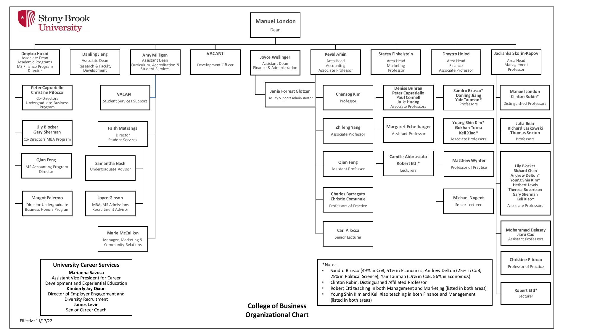
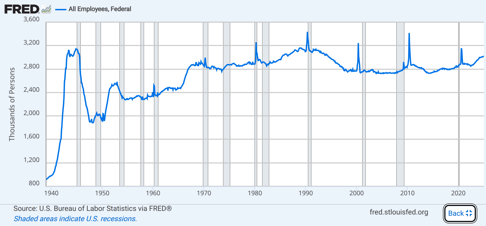
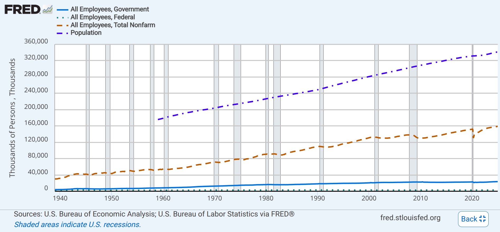
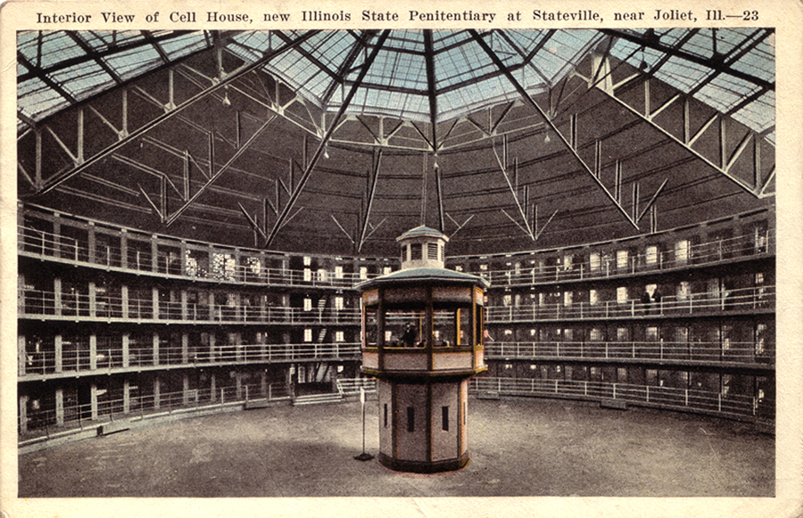

Now that we understand [meaning](./Ch_4_Meaning.qmd) and [socialization and interaction](./Ch_5_Interaction.qmd), we can take the next step of abstraction in our sociological journey. The central object of sociological analysis is people-in-society, and the binding agents connecting them are **social structures**, the regular patterns of interaction which organize social life.

Social structures come in three main varieties: groups, organizations, and networks.

# From Aggregates and Groups

The simplest social structures are groups, which emerge from aggregates.  **Aggregates** are simple collections of people who happen to be together in a particular place but do not significantly interact or identify with one another.  **Groups,** meanwhile, *do* regularly interact, share expectations about each others' behavior, and share at least some sense of common identity.  As these definitions imply, the two key distinctions of "group-ness" are (1) whether there is ongoing, regular interaction, and (2) whether members have a sense of collective identity.

## Kinds of Groups

There are two main ways to differentiate kinds of groups.  The first is how intensive, emotionally-laden, and face-to-face the group is.  We call groups that express all of these features strongly **primary groups**, and all other kinds of groups **secondary groups**.^[There are ambiguous cases that are not clearly primary or secondary groups.  For instance, what about a very intensive on-line e-sports team?  Or what about a religious *denomination* versus a specific *church* or *congregation*?]  One example of this is sports teams: if you play on a serious team, chances are you are participating in a *primary* group, since you'll see people often at practice, interact with them face-to-face, and being a part of that team probably matters a lot to your self-identity.  Meanwhile, if you *cheer for* a team, you might still think of yourself as a part of that team's "fandom," but you don't directly interact with everyone outside of getting together to cheer for your team, and (if you're healthy), your fan affiliation is a less-salient part of your identity.

At a higher level of generality/abstraction, there is another way to distinguish kinds of groups.  At the most general level, all groups depend on **in-group/out-group distinctions**, which is to say, they depend on their force on the claim that there is *some* fundamental difference within a population between members of an **in-group** and those of an **out-group**.  The in-group is usually said to have higher status and privilege than the out-group, and the disitinction between then can be the basis for exclusion or even violence.  Because groups are fundamentally social constructions, however, it is rarely predictable exactly *what* will form the basis of categorical in-group/out-group distinctions, and they typically range across all possible bases for identity.

We also use our membership in groups as a standard to judge the propriety of our own behaviors.  We call these groups **reference groups** and they can either be **concrete** (in the case of asking "what would my family think of this decision") or **imagined** (in the case of asking "I want to be a doctor, and what would doctors think of taking this class"?)

## Group Size

There is a paradox to group size: as groups grow larger, they become more stable (because, if any individual member exits, the group does not dissolve), but also grow less intense (because, since there are more members of the group, there are also many more potential relationships within it).

## Conformity and Groups

Groups exert enormous coercive power on their members.  This has been shown by two famous experiments (and countless others thereafter).  The first one was conducted by [Solomon Asch](https://en.wikipedia.org/wiki/Asch_conformity_experiments) in 1951 and showed that, in an experimental design where a participant is led to believe that a group they are participating in has a false belief (about the length of various straight lines).  About a third of time, the participant would yield to that false group belief.

More famously, in 1961, [Stanley Milgram](https://en.wikipedia.org/wiki/Milgram_experiment) conducted his famous experiments in New Haven, Connecticut.  In *this* experimental design, the participant is led to believe that they are torturing another participant to death, following the directions of the experimenter.  In the original experiment, *every* participant administered 300 volt shocks to their (in reality, unharmed) "fellow-participants."

# From Groups to Organizations

## Especially Formal, Modern Organizations: Bureaucracies

From antiquity, there has been a case of formal organization that has played a special historical role, and, in the modern era, has become *the* mode of organizing complex social life: the **bureaucracy**.  This kind of organization is distinguished from others by its very high degree of **formal rationalization**, which is to say, the extent to which its features efficiently and effectively deliver any given end.

The sociologist Max Weber outlined seven features of what he called the "ideal type" of bureaucracy:^[Here, we can treat an ideal type as similar to an index: a bureaucracy is "more of" a bureaucracy the more of these features it fulfills; but not every bureaucracy has every single one of these features to the same degree.  However, the most extreme bureaucracy we can imagine would have them all and express them intensively.]

1. *Defined Jurisdictional Areas.* Bureaucratic organizational positions are defined by the "domains" they oversee. At Stony Brook, for instance, I am a professor *of sociology,* and therefore cannot automatically teach courses in other disciplines, because they are "not in my area."
2. *Expert Training.* Bureaucratic positions are defined by their holders' *expertise*, which is to say demonstrated qualification for the position.  In complex societies, moreover, it is usually impossible to verify training through personal networks and direct experience of a person alone, so organizations usually supplement such measures with credentials, such as, in the case of university professors, the highest academic degrees in their disciplines (usually a PhD).
3. *Clear-Cut Hierarchy.* In an ideal-typical bureaucracy, defined jurisdictional areas carry hierarchies with them; just as people have areas they oversee, so too do their underlings have clear lines of authority that trace their way up to the overall leader of the organization.  This means that, when this go wrong, there are clear avenues of responsibility and appeal from one person to their supervisor, all the way up to the head of the organization.
4. *Written Rules of Conduct and Procedure.* Bureaucracies rely on cultural technologies to function, and one of the most important is writing. On the one hand, written records themselves enable the processing of vast inputs and outputs (whether people, goods, or even knowledge) through a bureaucracy, not least because writing allows each of those inputs and outputs to be abstractly represented, and consequently structurally-equivalent officials can deal with the same "case" based on that case's "file," without needing personal knowledge of the history of that case.  On the other hand, bureaucracies often have extremely intricate written procedures for how officials themselves should go about their work, which means that, when they deviate from these prescribed norms of behavior, they can be held accountable.
5. *Full-time Salaried Officials.* Bureaucrats are so effective, in part, because they can concentrate on their jobs. This sounds simple, but think about how hard it would be for someone to master the ins-and-outs of working with bureaucratic cases if they *also* had to worry about another position, and consequently could only be around for restricted hours, devote comparatively little time to the organization, and so on.
6. *Separation between Organizational and Private Life.* Bureaucracies are at their most efficient when an individual bureaucrat is "separable" from their job.  That is, in principle *any* qualified and trained candidate could do the same work as any individual bureaucrat, and so the organization does not depend on the particular characteristics of any one worker.
7. *Organizational Ownership fo the Means of Production.*  Finally, bureaucracies work so efficiently, in part, because they do not depend on any individual bureaucrat's possessions to function, and instead the organizations supply their own.  Think, again, of Stony Brook: if they asked every member of physical plant (the organizational division that does maintenance on buildings and grounds) to use their own trucks at work, that would only work if (a) everyone had trucks of their own to use, and (b) individually was willing to use them for work.  It is *far* more efficient for Stony Brook to maintain a fleet of its own vehicles and equipment to make sure that its facilities are actually maintained.

The hallmark of bureaucracy, as shown below, is the organizational chart. (This one is from the Stony Brook College of Business, but you could replicate it for literally any bureaucracy you want; they're very common.)  Note how it expresses clear organizational hierarchy (points 1 and 3 above), and carefully delimits the expertise different positions at different ranks hold (point 2; a "Professor of Practice," for instance, need not have a PhD, whereas an Assistant, Associate, or Full Professor does).  And the very document itself is a written record of the conduct and procedures fo the unit, insofar as it can be referred to if someone is "out of their lane" (point 4).

## The Functions and Dysfunctions of Formal Organizations

### Functions

In mainstream American culture, we are used to thinking of bureaucracies as ineffecient and "bad."  But I want to argue that the story is more complicated.  To begin with, consider "the government," in all its messiness.  We're used to thinking of the government as a source of red-tape and impediments, but if you consider its size relative to the rest of the United States, you quickly get a sense of how few people are able to undertake all the functions that keep society functioning.  To begin with, we can see that the federal government is made up of about 3 million people (here excluding the military).

And we can add state, county, and local government employees to that count as well (which would, by the way, include SUNY professors like me---we are state employees!), which would boost that count to just shy of 24 million people.

But *then*, if we take a step back, and consider those 27-or-so million government workers relative to the population of the United States, we get a sense of how *small* the "government bureaucracy" really is.  (The US Census Bureau [estimates](https://www.census.gov/popclock/) that the US Population is about 343 million right now, which means that Government at all levels adds up to just under 8% of the total population.)

### Dysfunctions

At the same time that bureaucracies are impressively effective, they also manifest negative functions.  One of the biggest comes from a point implied by bureaucracy's very efficiency: as organizations, bureaucracies can very efficiency pursue *given* ends, but it can sometimes be difficult to get them to stick to the ends that they have been given.  That is an elliptical way of saying that bureaucracies can sometimes become **decoupled** from their designed purposes, beginning to pursue different ends.  When we accuse an organization of "losing its way," for instance, what we typically mean that it was designed for an explicit purpose, but has drifted to actually pursuing another.

Another "dysfunction" (which you might actually view as a "function," depending on your value commitments) of bureaucracies is that when they inputs and outputs of bureaucracy are *people*, the very value-neutrality and efficiency of bureaucratic operations mean that discipline, control, and even violence can be exerted by a small minority on very large populations.  The historian and social theorist Michel Foucault called this effective discipline **panopticism**, which he built from an analogy of the architecture of some prisons.

Foucault noticed that, given this prison design, all of the prisoners had to behave *as though* they were under observation at all times.  (Their prison cells were open to the central guard-tower, but they could not tell if the guard was directly looking into their cells.)  Accordingly, instead of one guard being needed to observe one prisoner, very few guards could exert discipline on a very large population of prisoners because of the prison's design.

Foucault thought that panopticism also worked by analogy to describe formal organizations' power to discipline people, especially when enabled by technology.  Indeed, contemporary examples of panoptic orgnaizations abound, from consumer-oriented "nudges" by apps like [diet monitors](https://www.weightwatchers.com/us/blog/introducing-new-weight-watchers), [language-learning programs](https://www.reddit.com/r/duolingo/comments/1c2gkt6/sad_duolingo_icon_mega_thread/), and even [anti-pornography habit-builders](https://www.covenanteyes.com/about/?gad_source=1&gad_campaignid=407188357&gclid=CjwKCAjwxeHWBhBPEiwAiqtQ-aMtPL_Vfnj_ODa3GomXjKMG3YhIVtROQqqOkd4YNbcvgFrxEH8bThoCoKkQAvD_BwE) (which all monitor our activity, collect it, and either digest it back to us or share it with others), to state-sponsored [observation of our movements](https://www.flocksafety.com/products/license-plate-readers), to [direct monitoring of our behavior in the university](https://it.stonybrook.edu/services/respondus) through "virtual proctoring."

# Networks

We have so far emphasized the importance of formal organizations, but in sociology, social structures can also be represented as **networks**, or graphs of entities and their connections to one another.  At their most abstract, networks can be used to represent *any* kind of entity and *any* kind of tie, but in typical *social* network analysis, the entities are usually people or organizations, and the ties are typically traces of social interactions

## Findings of Network Analysis

Network analysis has provided striking findings in the recent history of sociology.  Among them:

- That social networks tend to exhibit [patterns of closure](http://www.journals.uchicago.edu/doi/abs/10.1086/502694), meaning that as social network dynamics unfold, more ties will tend to form across different nodes in the network.
- That social networks also display *homophily*, or that [similar entities](http://journals.sagepub.com/doi/abs/10.1177/000312240707200507) within a network will tend to form ties with other entities like them.
- That behaviors and feelings can spread along social network ties (similar to how a disease spreads), [called](http://www.pnas.org/content/111/24/8788.short) *contagion*.
- That entities perched between different regions of a network---which is called a *brokerage* position---tend [to have](http://www.journals.uchicago.edu/doi/abs/10.1086/230190) more power than those deeply embedded in one region or another.
- And that networks provide enormous social resources, especially when people and entities leverage the "strength of weak ties," [drawing](https://www.jstor.org/stable/pdf/2776392.pdf) new resources and information not from other entities closely tied to them, but from more distant "friends of friends."

## The Interface of Network and Organization

A final point of tension is worth mentioning, especially when networks are considered in comparison to organizations.  Above, organizations were represented in terms of strict hierarchies, and much network research emphasizes the horizontal connections among entities given a large variety of ties.  Given this, it is worth asking whether the difference between networks and organizations is one of perspective (that is, *epistemological*) or one of concrete difference in the structure of social reality (that is, *ontological*).