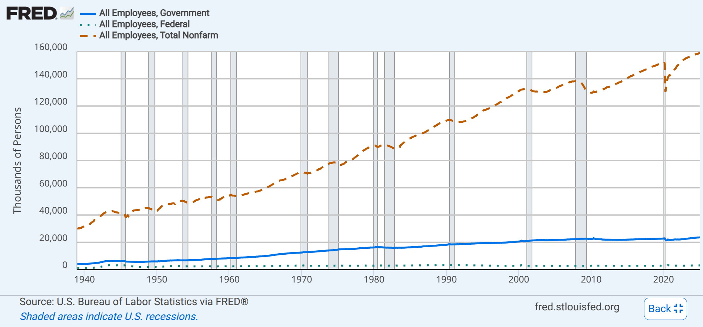

Now that we understand [meaning](./Ch_4_Meaning.qmd) and [socialization and interaction](./Ch_5_Interaction.qmd), we can take the next step of abstraction in our sociological journey.  The central object of sociological analysis is people-in-society, and the binding agents connecting them are **social structures**, the regular patterns of interaction which organize social life.

Social structures come in three main varieties: groups, organizations, and networks.

# From Aggregates and Groups

## Kinds of Groups

## Group Size

## Conformity and Groups

# From Groups to Organizations

## Especially Formal, Modern Organizations: Bureaucracies

## The Functions and Dysfunctions of Formal Organizations

# Networks

## Findings of Network Analysis

## The Interface of Network and Organization

# The Internet and Organizations
