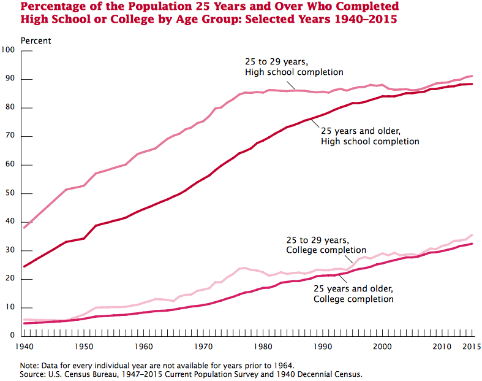
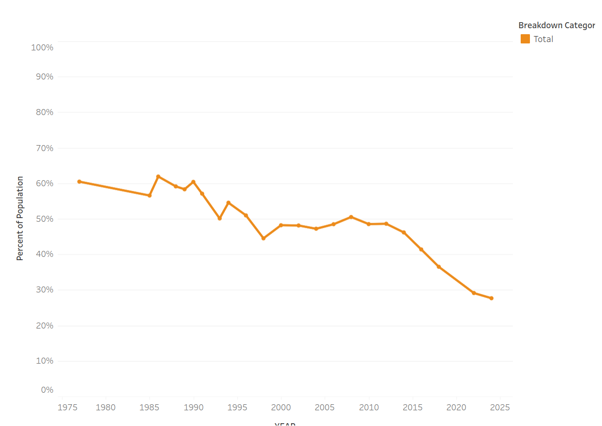
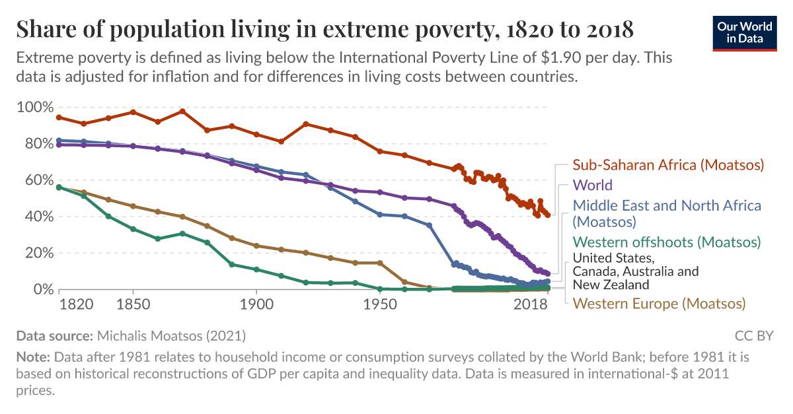
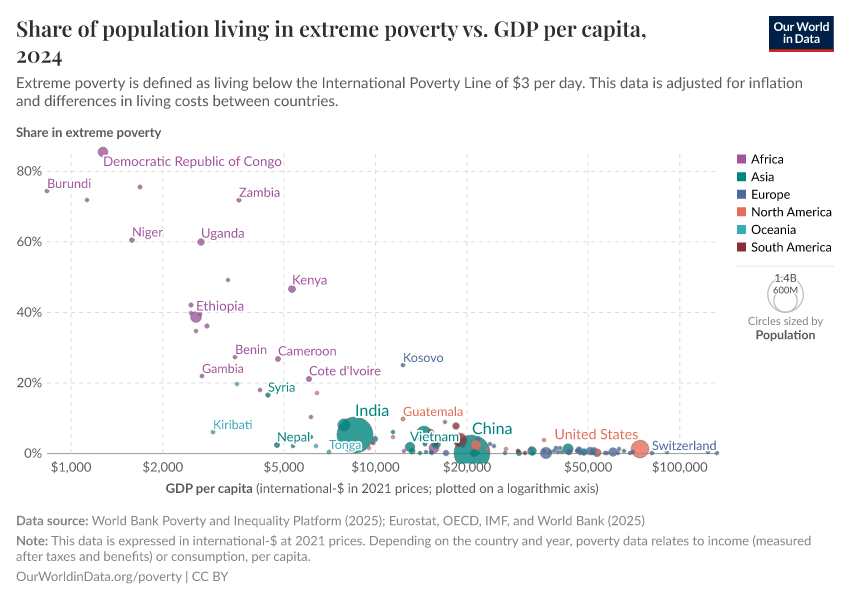

# Introduction

So far in the course, we have emphasized how your social identity is structured, in part, according to your social position. This set of assumption about "who you are" give others information during interactions, and, while they do vary somewhat across social settings, there are also more durable aspects of your social identity that carry *across* such settings.

# Basic Concepts

In mordern societies, these durable markers are almost always distributed **unequally**. This means, simply, that within a given society, some people have more of that marker, and some less. One key factor of this unequal distribution is that the marker in question is subject to **scarcity**; there is not an infinite supply of it, and so not everyone can have all they want.

It is perhaps easiest to think of this situation via money. Money is a marker of the command over the goods and services of others (this is what you do when you exchange it for things and other people's labor). And because the world of material goods and other people's time is not infinite, not everyone can have an infinite amount of money (because, if they did, money would literally be able to buy less and less---this is what inflation is.) Consequently, in a normally-functioning modern economy, the amount of money in circulation is not exactly fixed,[^1] but it is scarce---not everyone can have all they want. And as social dynamics (which we discuss below) play out, **structural inequalities** in the distribution of money emerge: who gets more and who gets less tends to be determined by social markers, which we tend to group under the broad term "class."

[^1]: To prevent *deflationary spirals*, modern monetary policy usually aims for a low level of inflation. This encourages people to actually spend money (because otherwise it will be able to buy less) rather than hoarding it.

## A Closer Look at Class

### Prologue: Before Class

Before we directly excamine the components of class (with an eye to their complexity), let us first note that class is historically not the only system of structural inequality. One major historical alternative was **slavery**, a system where some people (and thus their labor) were directly owned by others, and thus the major axis of inequality was freedom and unfreedom. **Caste**, meanwhile, was (and is still, in some parts of the world) a system in which religion prescribed certain social statuses on people by virtue of their birth, and prohibited some kinds of inter-caste interactions and movement between classes over the life course. **Ethnic inequality**, finally, is a system of structural inequality centered on shared cultural identities that are made salient in contrast to other identities in a society.

### Components of Class

As noted, "class" is a *very* broad concept. Sociologists agree that it centers on four elements, and there is controversy about one more.

#### Income

The first major element of class is **real income**, or the money wages and earnings of a person as adjusted for inflation. It is important to measure **inflation**, meanwhile, because under typical economic conditions, the same amount of money loses its purchasing power (literally, the amount of goods it can be used to buy) over time. Thus, in your own lifetimes (i.e., since 2005), it now [takes](https://www.bls.gov/data/inflation_calculator.htm#) about \$1.75 to purchase the same amount that \$1 could when you were born.[^2] Or, to put it another way, a dollar at your birth is worth about 75% less now.

[^2]: That number is even more dramatic for the year I was born: it takes \$3.71 to buy what \$1 could when I was born.

Another major adjustment that is commonly made to income is its regional **purchasing power**. Simply, this means that the cost of living in different places can be *wildly* different (even within the U.S.), and thus, say, \$100,000 does not go nearly as far in Manhattan as it does in McPherson, KS.[^3]

[^3]: For instance, [this](https://www.zillow.com/homedetails/200-N-Lakeside-Dr-McPherson-KS-67460/91206367_zpid/?utm_campaign=zillowwebmessage&utm_medium=referral&utm_source=txtshare) 6 bedroom, 4 bathroom house in the center of McPherson is on the market for \$200,000, which, in Manhattan, would buy you the right to be laughed at by a real-estate agent.

#### Wealth

For most people in the united states, real income is the key determinant of their economic well-being. For others, however, we must add **wealth** when considering their class. This is usually measured by "net worth," which is to say, the total value of all your debts (loans etc.) subtracted from the total value of all your assets (real estate, cars, stocks, money, etc.).

Wealth can be much more difficult to measure than income, primarily because, in the U.S., most people know their incomes (from their pay stubs and taxes) but not everyone knows that total value of their debts and assets (because this can involve complex calculations). However, one of the [best surveys](https://www.federalreserve.gov/publications/files/scf26.pdf) we have available shows vast disparities: in 2026, the median net worth for the top ten percent of U.S. households was about 5 million dollars. The median net worth for the bottom quarter of households was \$1,700. That is *almost* 3,000 times smaller.

#### Education

Another major element of class is **education**, or the total amount of formal training someone has received, usually measured by their total years of schooling or highest degree received. In the U.S., this has changed historically. In the 1940s, less than 40% of the population ever held a high-school degree (or equivalent); today, almost everyone (about 90%) do. And about 5% obtained a college degree in 1940; today, that number is about a third. (And *very* few people hold the highest educational degree, a PhD; that is about 1 in 50 people today, or about 2% of the population.)

#### Occupation

Class is also composed of a person's **occupation**, or their paid or unpaid employment. Occupations can obviously vary in terms of how they are paid, but they also vary in terms of how much education they require and how they are *seen* by others (which is to say, the status they carry). [This website](https://occupational-prestige.github.io/opratings/opratings.html) provides a searchable ranking of occupational prestige using data from the US Department of Labor. It shows that (again, somewhat predictably) various kinds of Doctor and Lawyer rank the very highest, while dishwashers rank the lowest. (If you're curious, "sociologist" ranks at 60.59 on a 100-point-scale, but substantially lower than the rest of the "Life, Physical, and Social Sciences" field.)

#### The Controversial Element: Lifestyle

The controversial component of class is **lifestyle**. This comprises what people consume, how they are educated, who they associate with, and even the kinds of cultural judgments they make. For instance, the sociologist Anette Lareau [@lareauUnequalChildhoodsClass2011] found that children from different class backgrounds were socialized to two very different "styles" of interacting with intstitutions. Children from working-class backgrounds were socialized into the *the accomplishment of natural growth*, which emphasized comparatively little structured play and fostered relatively little experience in challenging adverse decisions by authorities. The *concerted cultivation* practiced by middle-class families, meanwhile, socialized children into highly-structured institutional play (such as music lessons, camps, and so on) while teaching them to question and challenge decisions they disagreed with.

There is also some evidence that these lifestyle differences extend to cultural taste. Consider the following table, which shows the percentage of respondents who like or dislike classical music accoding to their "subjective" (i.e., self-assessed) class. As you can see, the appeal of classical music rises with class position, and distaste for it rises class falls.

|                      | Lower Class | Working Class | Middle Class | Upper Class |
|:--------------------:|:-----------:|:-------------:|:------------:|:-----------:|
|  Like It Very Much   |     2%      |      37%      |     51%      |     8%      |
|       Like It        |     4%      |      43%      |     50%      |     3%      |
|    Mixed Feelings    |     5%      |      42%      |     49%      |     3%      |
|      Dislike It      |     9%      |      58%      |     31%      |     1%      |
| Dislike It Very Much |     10%     |      51%      |     38%      |     1%      |

: Appeal of Classical Music by Subjective Class, General Social Survey

# Theories of Stratification and Class

There are a multitude of theories of class and stratification in sociology, and we will touch on a few of the most important.

## Marx

One of the most important theories of class and stratification in sociology was developed by Karl Marx. Marx thought that one's class position was defined by one's relationship to the **means of production**, or the machinery necessary to actually produce what is necessary to survive and live in modern societies. Some people in society, called the **bourgeoisie** or **capitalists**, owned the means of production. Under capitalism, Marx thought, the vast bulk of society was made up of **workers** or the **proletariat**, which sells their own labor power as though it is a commodity (this is what a "wage" is---the price your labor is worth on the market of labor power).

A key dynamic of capitalism, according to Marx, was that inequality would worsen under capitalism, concentrating wealth in the hands of capitalists and progressively immiserating the proletariat. Marx (mistakenly, as it happens) thought that this dynamic would inevitably lead to a global worker-led revolution which would institute communism. But what *has* been validated by careful analysis (conducted by an economist) is the observation that, in the absence of regulation, inequality worsens under capitalism [@pikettyCapitalTwentyfirstCentury2017].

### E. O. Wright

In addition to the failures of Marxist theory to predict the outcome of capitalist dynamics (one of its avowed goals), the theory has also been modified to address another empirical drawback. As you might have noticed in the above description, Marx's theory argues that there is an austere gap between capitalists and workers. Yet, if we examine the contemporary landscape of work in the U.S., we find that a multitude of workers either have aspects of management in their work, perhaps own their own small business and still work, or (even more frequently) depend on retirment income on stocks and bonds, which make them (very small scale and indirect) capitalists. The sociologist Erik Olin Wright recognized and analyzed these **contradictory class locations**, and noted that they were becoming more widespread in contemporary capitalism, and that they complicated the dynamics if capitalist change [@wrightClasses1985].

## Functionalists

If Marxism sees conflict among classes with competing interests as the central dynamic of society, functalists tend to emphasize social order. Accordingly, a functionalist theory of inequality emphasizes the "necessity" of inequality [@davisPrinciplesStratification1945]. This is primarily because society "needs" to differentially reward people who perform tasks that are more "valuable" for overall social orders, and these rewards are evidence (tautologically) of those tasks' increased importance.

## Weber

Marx and the structural functionalists overwhelming concentrate on *economic* factors when thinking about class. The sociologists Max Weber, however, recognized that class was also a composite of **social status**, or the ways that people evaluate the positions and esteem of others in a society. Weber argued that this different axis of inequality created social positions (for instance, the clergy) that did not neatly fit into the capitalist/worker distinction. Additionally, the invocation of identity and meaning entails that some social positions among "workers" might be accorded very different statuses and, therefore, mean that people occupying them might have very different identities. For instance, skilled tradesmen might not necessarily see themselves as natural allies of unskilled laborers, managers might not identify with capitalists, and so on.

## Bourdieu

Finally, Pierre Bourdieu, in his monumental *Distinction* [-@bourdieuDistinctionSocialCritique1984] argued that there was yet another neglected dimension of inequality and class, which he named **cultural capital.** One of the crucial theorists of "lifestyle" and class discussed above, Bourdieu argued that cultural captial was the ability of people not only to make judgments themselves, but also to claim that those judgments are authoritative and legitimate. For instance, in the case of art, "high art" wasn't just reducible to who had the money to pay for art, but rather to a special class of *critics* who were recognized with the ability to distinguish between "good art and bad." Crucially, this rarely correlated directly with other markers of class, but observed a dynamic all its own.

# Class in the United States

## Prologue: Measuring Poverty

It is surprisingly difficult to measure poverty. One reason for this is because to be "poor" is to be poor *relative to some standard.* At a basic level there are two such standards, and each standard has its own measure of poverty.

The first of these is **absolute poverty**, which measures poverty according to the costs of fulfilling basic life needs. This is the standard used by the federal government, which sets the "poverty line" at three times the assumed cost of a nutritionally-adequate diet per person. (This means that, [in 2026](https://aspe.hhs.gov/sites/default/files/documents/b1bfa16b20ae9b89d525bc35de7c1643/detailed-guidelines-2026.pdf), the poverty line for a single person, excluding Hawaii and Alaska, is 15,960 dollars a year. That's \~\$43.72 a day.)[^5]

[^5]: Note also that this aboluste poverty measure is *not* regionally or cost-of-living adjusted (except for AK and HI)!

The second standard is poverty is measured relative to the standards of mainstream society, and is thus called **relative poverty.** Why use this measure? Simply, there is now lots of evidence that *feeling* poor relative to the rest of society has numerous poor effects on one's life, including on people's physical and mental health [@pickettHealthInequality2008].

## A Map of Class in the United States

The upper-class in the US is composed of families making more than about \$250,000 a year, is made of people who attended elite educational institutions, and whose wealth mostly comes from investment dividends. They comprise about 5% of the US.

The middle class, meanwhile, is (in the U.S.) a notoriously amorphous group comprising about 55% of society. Incomes range from \$125,000 to \$250,000 for the "upper middle class", who are usually highly-education professionals, and between \$60,000 and \$125,000 for the "middle middle class," working in occupations like skilled crafts and less-educated office workers.

Below the middle class stands the "working class," which is about 20% of the U.S. class structure, and is composed of less-skilled tradespeople and office workers, and whose income ranges from about \$30,000 to \$60,000.

Finally, the "lower class" are people who work full time at low wages (usually in retail or service work), part time, or not at all. They are about 20% of households, and their income is usually below \$30,000.

## Some Consequences: Class Matters

Our assigned reading for this unit, "Class Matters," explores the consequences of class on three New Yorkers (each from a different class) who had the same kind of heart attack.

The first, a high-class architect, is surrounded by friends who identify his heart attack immediately, receives the highest-quality care immediately, and is able to retire on favorable terms early from his firm in order to concentrate on this recovery. As you might guess, his health some time later is "better than ever."

The middle class case in the story arrives the hospital relatively promptly, but for cost reasons, is only given the best treatment after cheapter de-clotting drugs are tried first. He struggles to maintain a positive diet, and while he is able to step back his physical responsibilities at work, is not able to immediately retire. As the story closes, his health is middling.

The lower-class case works as a janitor from Eastern Europe, and she does not have her heart attack treated until well after it has taken place (she tries the "home remedy" of a shot of vodka first), cannot stop working, and must manage travel to and from medical appointments on public transit, which can take hours. By the end of the story, again as one might predict, her health is failing, and she has become a "full-time patient."

The point of this example is that it mimics a natural experiment: three people have the same medical issue, and what (it seems) explains their actual health outcomes is not a difference in their injuries, but rather differences in their class positions, which determine the quality of their care and their ability to concentrate on their recoveries.

## Afterword: "Cultures of Poverty"

One of the greatest controversies in contemporary society, given the very high levels of relative poverty demonstrated in the U.S., is what causes people to be poor. Observers note that a substantial group of poor people *do* work (about 1/3 of people 16 and older who fell below the federal poverty line worked in the last year), and that poverty is disproportionately black and latino. And, even in places where poverty has substantially improved (such as among the elderly), there are still large racial and gender gaps (black older women living along are about ten times more likely to be poor as White married elderly men).

In U.S. politics, one common response (comprising about a third of the population) is that the poor---and especially, the *racialized* poor---do not work sufficiently hard to lift themselves out of poverty.[^6]

[^6]: The survey question was: "On the average Black people have worse jobs, income, and housing than white people. Do you think these differences are...Because most Black people just don't have the motivation or will power to pull themselves up out of poverty?" [Source](https://gssdataexplorer.norc.org/trends?category=Civil%20Liberties&measure=racdif4_r1)

In a more sanitized vocabulary, these arguments also exist in the social sciences. Broadly, the competing poles argue, on the one hand, that poverty happens because of structural factors out of the control of any individual or subculture. On the other hand, some social scientists argue that there *are* specific cultural factors (whether it is socialization into a lack of effort, or to lack of knowledge of how to save, and so on) that keep people poor.

# Some Notes on World Poverty

Two major trends are observable regarding world poverty. The first is temporal: poverty has fallen, by most measures, remarkably over the last 200 years.

Second, there is a high correlation between reduction in extreme (absolute) poverty and the overall economic development of a country. As economies on the whole become wealthy, there is almost no absolute poverty, but as the economy on the whole is poorer, absolute poverty increases.

